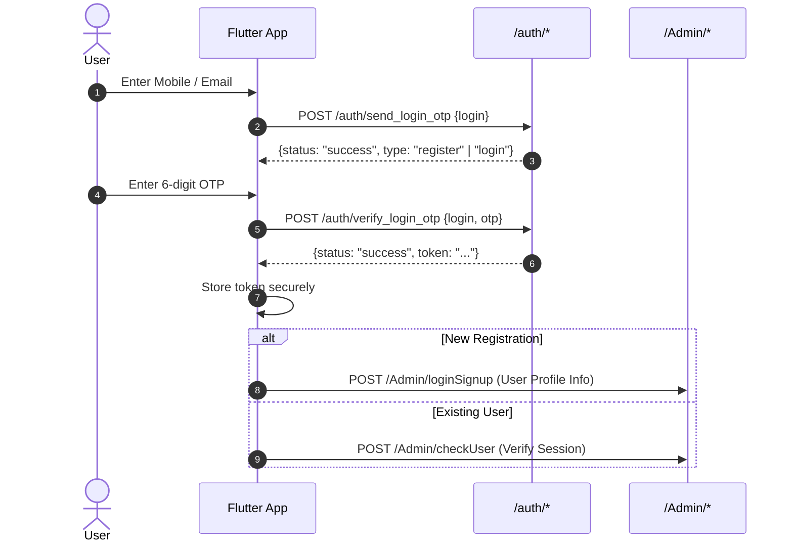

# Dr. Hair API Documentation

This document provides a comprehensive specification of all backend APIs used in the Dr. Hair application (extracted from the reference React Native implementation) for implementation and integration into the **Flutter** application (`flutter_app`).

---

## 📌 Table of Contents
1. [General Configuration & Setup](#general-configuration--setup)
2. [Authentication Flow](#authentication-flow)
3. [API Endpoints Summary](#api-endpoints-summary)
4. [Detailed Endpoint Specifications](#detailed-endpoint-specifications)
   - [1. Send Login / Signup OTP](#1-send-login--signup-otp)
   - [2. Verify OTP](#2-verify-otp)
   - [3. Check Authorized User](#3-check-authorized-user)
   - [4. Register User](#4-register-user)
   - [5. Get User Profile](#5-get-user-profile)
   - [6. Update User Profile](#6-update-user-profile)
   - [7. Update Profile Picture](#7-update-profile-picture)
   - [8. Submit Hair Test Form](#8-submit-hair-test-form)
   - [9. Get Hair Test History](#9-get-hair-test-history)
   - [10. Get Treatment History by Test ID](#10-get-treatment-history-by-test-id)
   - [11. Get Reviews](#11-get-reviews)
5. [External Services & Deep Links](#external-services--deep-links)
6. [Flutter Dio / Endpoints Implementation Reference](#flutter-dio--endpoints-implementation-reference)

---

## ⚙️ General Configuration & Setup

### Base URLs
- **Local / Development**: `http://192.168.1.8/drhair`
- **Production**: `https://drhair.health`

### Headers & Authentication
- **Content-Type**:
  - `application/json` (for default JSON requests)
  - `multipart/form-data` (for form submissions with or without file attachments)
- **Authorization**:
  ```http
  Authorization: Bearer <auth_token>
  ```
  *(Token received upon successful verification in `verify_login_otp` and stored in secure storage).*

---

## 🔐 Authentication Flow



---

## 📋 API Endpoints Summary

| # | Endpoint | Method | Content-Type | Auth Required | Flutter Feature Module |
|---|---|---|---|:---:|---|
| 1 | `/auth/send_login_otp` | `POST` | `multipart/form-data` | ❌ | `features/auth` |
| 2 | `/auth/verify_login_otp` | `POST` | `multipart/form-data` | ❌ | `features/auth` |
| 3 | `/Admin/checkUser` | `POST` | `application/json` | ✅ | `features/auth` / `features/hair_test` |
| 4 | `/Admin/loginSignup` | `POST` | `multipart/form-data` | ❌ / Optional | `features/auth` / `features/hair_test` |
| 5 | `/Admin/get_profile` | `POST` | `multipart/form-data` | ✅ | `features/profile` / `features/treatment` |
| 6 | `/Admin/updateProfile` | `POST` | `multipart/form-data` | ✅ | `features/profile` |
| 7 | `/Admin/profileUpdate` | `POST` | `multipart/form-data` | ✅ | `features/profile` |
| 8 | `/HairTest/submit_form` | `POST` | `multipart/form-data` | ✅ | `features/hair_test` |
| 9 | `/HairTest/hair_test` | `POST` | `application/json` | ✅ | `features/treatment` |
| 10 | `/HairTest/get_treatment_history/{id}` | `GET` | `application/json` | ✅ | `features/treatment` |
| 11 | `/Review/review_get` | `POST` | `application/json` | ❌ | `features/home` / `features/reviews` |

---

## 📖 Detailed Endpoint Specifications

### 1. Send Login / Signup OTP
Initiates authentication by sending a one-time password to the user's mobile number or email address.

- **URL**: `{BASE_URL}/auth/send_login_otp`
- **Method**: `POST`
- **Content-Type**: `multipart/form-data`
- **Headers**:
  ```http
  Accept: application/json
  ```
- **Request Body (FormData)**:
  | Key | Type | Required | Description |
  |---|---|---|---|
  | `login` | `String` | Yes | Phone number or email address |

- **Sample Response (Success)**:
  ```json
  {
    "status": "success",
    "message": "OTP sent successfully to your number.",
    "type": "login" // or "register" / "new"
  }
  ```

---

### 2. Verify OTP
Verifies the 6-digit OTP entered by the user and returns an authentication JWT/Bearer token.

- **URL**: `{BASE_URL}/auth/verify_login_otp`
- **Method**: `POST`
- **Content-Type**: `multipart/form-data`
- **Request Body (FormData)**:
  | Key | Type | Required | Description |
  |---|---|---|---|
  | `login` | `String` | Yes | Mobile number or email address |
  | `otp` | `String` | Yes | 6-digit verification code |

- **Sample Response (Success)**:
  ```json
  {
    "status": "success",
    "message": "OTP verified successfully.",
    "token": "eyJhbGciOiJIUzI1NiIsInR5cCI6IkpXVCJ9..."
  }
  ```

---

### 3. Check Authorized User
Verifies whether the current user session/token is valid and retrieves authorization metadata.

- **URL**: `{BASE_URL}/Admin/checkUser`
- **Method**: `POST`
- **Headers**:
  ```http
  Authorization: Bearer <token>
  Content-Type: application/json
  ```
- **Request Body**: `{}` *(Empty JSON payload)*
- **Sample Response**:
  ```json
  {
    "status": "success",
    "data": {
      "id": 12,
      "email": "user@example.com",
      "phone": "9876543210",
      "name": "Sunil Sharma"
    }
  }
  ```

---

### 4. Register User
Registers a new user with personal and demographic information during the intake/hair test journey.

- **URL**: `{BASE_URL}/Admin/loginSignup`
- **Method**: `POST`
- **Content-Type**: `multipart/form-data`
- **Request Body (FormData)**:
  | Key | Type | Required | Description |
  |---|---|---|---|
  | `name` | `String` | Yes | Full name |
  | `email` | `String` | Yes | Email address |
  | `phone` | `String` | Yes | Mobile number |
  | `age` | `String` / `int` | Yes | Age in years |
  | `gender` | `String` | Yes | Gender (`Male` / `Female` / `Other`) |
  | `city` | `String` | Yes | City name |
  | `occupation` | `String` | Yes | Occupation |
  | `platform` | `String` | Yes | Value: `'app'` |

- **Sample Response**:
  ```json
  {
    "status": true,
    "message": "User registered successfully."
  }
  ```

---

### 5. Get User Profile
Fetches the logged-in user's profile details.

- **URL**: `{BASE_URL}/Admin/get_profile`
- **Method**: `POST`
- **Headers**:
  ```http
  Authorization: Bearer <token>
  ```
- **Request Body**: `{}` *(Empty or FormData)*
- **Sample Response**:
  ```json
  {
    "status": "success",
    "data": {
      "id": 12,
      "name": "Sunil Sharma",
      "email": "sunil@example.com",
      "phone": "9876543210",
      "profile_url": "uploads/profile/12_avatar.jpg"
    }
  }
  ```

---

### 6. Update User Profile
Updates basic profile text details (name, email, contact).

- **URL**: `{BASE_URL}/Admin/updateProfile`
- **Method**: `POST`
- **Headers**:
  ```http
  Authorization: Bearer <token>
  ```
- **Content-Type**: `multipart/form-data`
- **Request Body (FormData)**:
  | Key | Type | Required | Description |
  |---|---|---|---|
  | `name` | `String` | Yes | Full name |
  | `email` | `String` | Yes | Email address |
  | `contact` | `String` | Yes | Contact phone number |

- **Sample Response**:
  ```json
  {
    "status": "success",
    "message": "Profile updated successfully."
  }
  ```

---

### 7. Update Profile Picture
Uploads and updates the user's avatar image.

- **URL**: `{BASE_URL}/Admin/profileUpdate`
- **Method**: `POST`
- **Headers**:
  ```http
  Authorization: Bearer <token>
  ```
- **Content-Type**: `multipart/form-data`
- **Request Body (FormData)**:
  | Key | Type | Required | Description |
  |---|---|---|---|
  | `action` | `String` | Yes | Value: `'upload'` |
  | `profile` | `File` (Binary) | Yes | Image file (`image/jpeg` or `image/png`) |

- **Sample Response**:
  ```json
  {
    "status": "success",
    "message": "Profile photo updated successfully."
  }
  ```

---

### 8. Submit Hair Test Form
Comprehensive multi-step hair evaluation questionnaire submission, including questionnaire answers and scalp photos.

- **URL**: `{BASE_URL}/HairTest/submit_form`
- **Method**: `POST`
- **Headers**:
  ```http
  Authorization: Bearer <token>
  ```
- **Content-Type**: `multipart/form-data`
- **Request Body (FormData)**:

  #### Personal Info
  | Key | Type | Description |
  |---|---|---|
  | `full_name` | `String` | Full name |
  | `email` | `String` | Email |
  | `phone` | `String` | Mobile number |
  | `age` | `String` | Age |
  | `gender` | `String` | Gender |
  | `city` | `String` | City |
  | `occupation` | `String` | Occupation |

  #### Hair Fall & Scalp Assessment
  | Key | Type | Description |
  |---|---|---|
  | `hair_fall_start` | `String` | When did hair fall start (e.g. `6 months ago`) |
  | `hair_fall_pattern` | `String` | Pattern of hair fall |
  | `daily_hair_fall` | `String` | Daily hair fall estimate |
  | `hair_fall_increasing` | `String` | Is hair fall increasing (`Yes`/`No`) |
  | `dandruff` | `String` | Dandruff status |
  | `scalp_condition` | `String` | Scalp condition (Dry, Oily, Normal) |
  | `scalp_symptoms` | `String` (JSON string) | Array of symptom strings |
  | `hair_type` | `String` | Hair texture / type |

  #### Lifestyle & Medical
  | Key | Type | Description |
  |---|---|---|
  | `medical_conditions` | `String` (JSON string) | Known medical conditions list |
  | `recent_events` | `String` (JSON string) | Recent life events |
  | `stress_level` | `String` | Stress rating |
  | `sleep_quality` | `String` | Sleep quality rating |
  | `diet_type` | `String` | Diet type (Veg, Non-veg, Vegan) |
  | `protein_intake` | `String` | Daily protein intake level |

  #### Treatment History & Goals
  | Key | Type | Description |
  |---|---|---|
  | `family_history` | `String` | Family history of hair loss |
  | `have_taken_treatment` | `String` | Previous treatments taken (`Yes`/`No`) |
  | `previous_treatments` | `String` (JSON string) | List of previous treatments |
  | `treatment_results` | `String` | Results of prior treatments |
  | `main_concern` | `String` | Primary hair concern |
  | `looking_for` | `String` | Desired outcome / goal |
  | `hair_loss_stage` | `String` | Selected hair loss stage (`Stage-1` to `Stage-6`) |

  #### Scalp Photos (Multi-angle)
  | Key | Type | Description |
  |---|---|---|
  | `photo_front` | `File` (Binary) | Front view scalp photo |
  | `photo_top` | `File` (Binary) | Top/crown view scalp photo |
  | `photo_left` | `File` (Binary) | Left profile scalp photo |
  | `photo_right` | `File` (Binary) | Right profile scalp photo |
  | `photo_back` | `File` (Binary) | Back view scalp photo |

- **Sample Response**:
  ```json
  {
    "status": "success",
    "message": "Hair test submitted successfully."
  }
  ```

---

### 9. Get Hair Test History
Retrieves past hair tests submitted by the logged-in user.

- **URL**: `{BASE_URL}/HairTest/hair_test`
- **Method**: `POST`
- **Headers**:
  ```http
  Authorization: Bearer <token>
  Content-Type: application/json
  ```
- **Request Body**: `{}`
- **Sample Response**:
  ```json
  {
    "status": "success",
    "data": [
      {
        "id": 101,
        "reference_no": "HT-2026-0042",
        "created_at": "2026-03-15 14:20:00",
        "hair_loss_stage": "Stage-2",
        "scalp_photos": [
          { "file_name": "front_101.jpg" },
          { "file_name": "top_101.jpg" }
        ]
      }
    ]
  }
  ```

---

### 10. Get Treatment History by Test ID
Retrieves doctor's diagnosis, notes, and treatment recommendations for a specific hair test reference number.

- **URL**: `{BASE_URL}/HairTest/get_treatment_history/{reference_no}`
- **Method**: `GET`
- **Headers**:
  ```http
  Authorization: Bearer <token>
  Accept: application/json
  ```
- **Path Parameter**:
  - `reference_no` (`String`): The unique reference ID of the hair test (e.g. `HT-2026-0042`).
- **Sample Response**:
  ```json
  {
    "status": "success",
    "data": [
      {
        "id": 5,
        "treatment_name": "PRP + Minoxidil 5%",
        "duration": "3 Months",
        "instructions": "Apply 1ml daily at night before sleep.",
        "doctor_name": "Dr. Hair Specialist",
        "date": "2026-03-18"
      }
    ]
  }
  ```

---

### 11. Get Reviews
Fetches public patient reviews and testimonials.

- **URL**: `{BASE_URL}/Review/review_get`
- **Method**: `POST`
- **Content-Type**: `application/json`
- **Headers**:
  ```http
  Accept: application/json
  ```
- **Request Body (JSON)**:
  ```json
  {
    "review_type": "doctor",
    "status": "active",
    "page": "home"
  }
  ```
- **Sample Response**:
  ```json
  {
    "status": "success",
    "data": [
      {
        "id": 1,
        "name": "Yashveer Soni",
        "rating": 5,
        "category": "Hair Fall Recovery",
        "message": "Visible improvements within 2 months!",
        "avatar": "https://images.unsplash.com/photo-1775138386053-5766c8c10e85",
        "is_verified": true
      }
    ]
  }
  ```

---

## 🌐 External Services & Deep Links

| Service | Format / URL | Description |
|---|---|---|
| **WhatsApp Chat** | `https://wa.me/{phone_number}?text={encoded_message}` | Opens WhatsApp with prefilled support message |
| **Google Maps** | `https://maps.app.goo.gl/HJxKSjwvvdY9pp1T7` | Clinic location navigation |
| **Reel Videos** | `https://drhair.health/video/{01..06}.mp4` | Short hair educational video clips |
| **Scalp Photo CDN** | `{BASE_URL}/uploads/scalp/{file_name}` | Scalp picture file uploads storage path |
| **Hair Stage Images** | `https://admin.sysboat.com/drhair/img/stage-{1..9}.jpg` | Diagnostic visual guide photos |

---

## 📱 Flutter Dio / Endpoints Implementation Reference

You can update `flutter_app/lib/core/constants/api_endpoints.dart` with the complete endpoint definitions:

```dart
class ApiEndpoints {
  ApiEndpoints._();

  // Base URLs
  static const String devBaseUrl = 'http://192.168.1.8/drhair';
  static const String prodBaseUrl = 'https://drhair.health';
  static const String baseUrl = prodBaseUrl;

  // Timeouts
  static const int connectTimeout = 30000;
  static const int receiveTimeout = 30000;

  // Auth & User Endpoints
  static const String sendLoginOtp = '/auth/send_login_otp';
  static const String verifyLoginOtp = '/auth/verify_login_otp';
  static const String checkUser = '/Admin/checkUser';
  static const String registerUser = '/Admin/loginSignup';
  static const String getProfile = '/Admin/get_profile';
  static const String updateProfile = '/Admin/updateProfile';
  static const String updateProfilePicture = '/Admin/profileUpdate';

  // Hair Test & Treatment Endpoints
  static const String submitHairTest = '/HairTest/submit_form';
  static const String getHairTests = '/HairTest/hair_test';
  static String getTreatmentHistory(String id) => '/HairTest/get_treatment_history/$id';

  // Reviews & Content
  static const String getReviews = '/Review/review_get';

  // Media CDN URLs
  static String scalpImageUrl(String filename) => '$baseUrl/uploads/scalp/$filename';
  static String profileImageUrl(String path) => '$baseUrl/$path';
}
```
